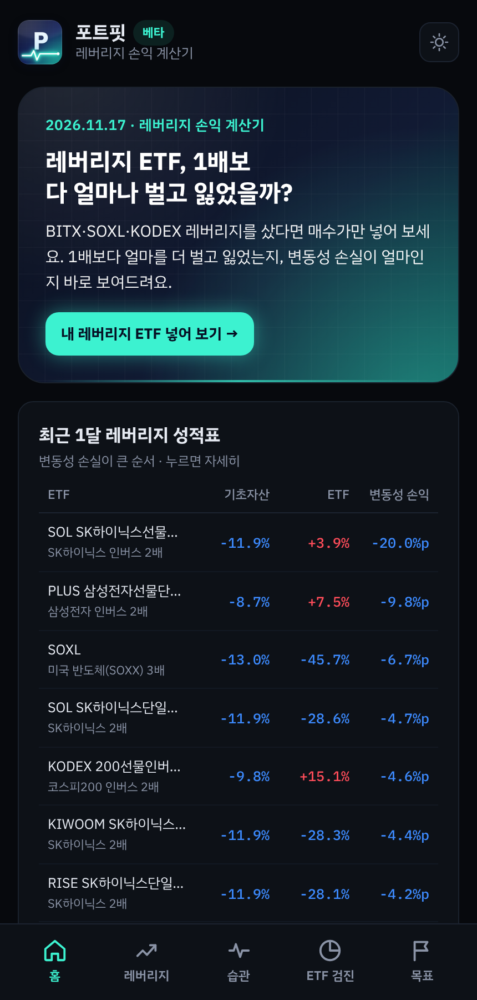
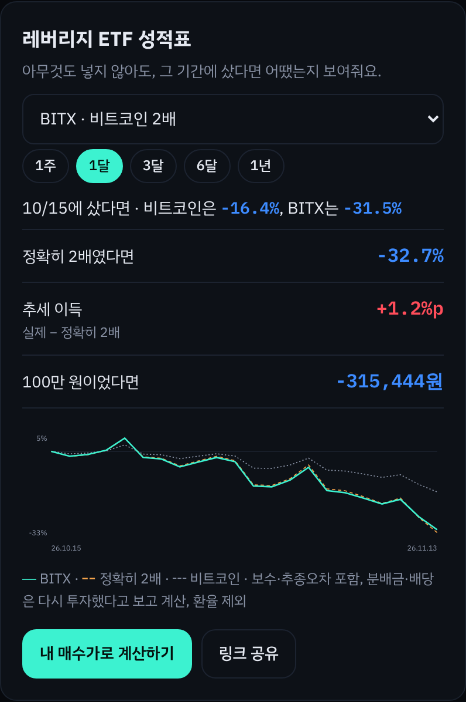
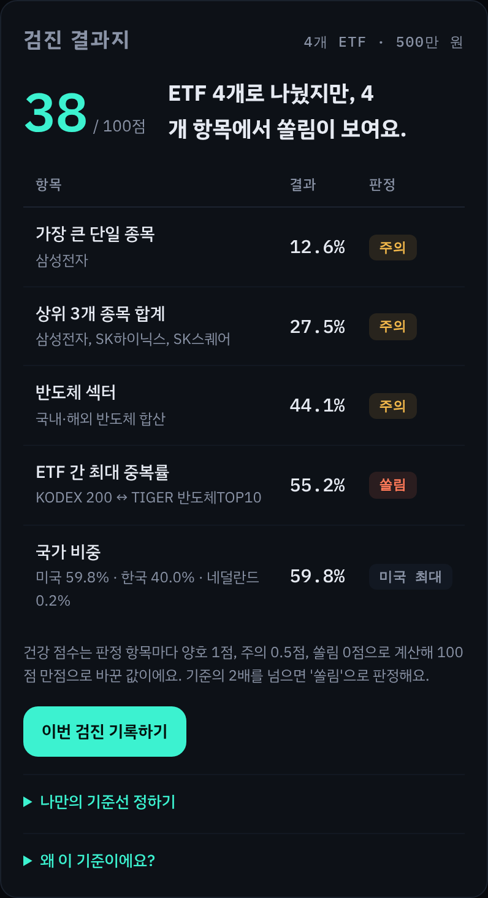
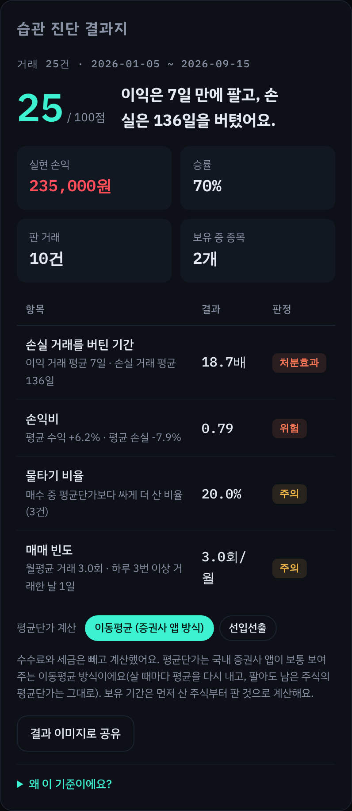

# 포트핏 (PortFit)

레버리지 ETF와 ETF 포트폴리오를 숫자로 점검하는 웹 계산기입니다.
종목을 추천하지 않고, 사용자가 이미 보유한 자산의 현재 상태만 계산해 보여줍니다.

- 서비스 주소: https://qkrwnsghd.github.io/portfit/
- 개발: 박준홍 (한림대학교 경영학과), 기획·데이터 수집·화면·서버 전 과정을 혼자 진행

## 화면

| 홈 | 레버리지 성적표 | ETF 검진 결과지 | 매매 습관 진단 |
| :---: | :---: | :---: | :---: |
|  |  |  |  |

## 만든 이유

레버리지 ETF는 "기초자산이 10% 오르면 20~30% 오른다"고 이해하기 쉽지만, 실제로는 매일 배율을 다시 맞추는 구조 때문에 기초자산이 제자리로 돌아와도 손실이 남는 경우가 많습니다. ETF를 여러 개 사면 분산투자가 된다고 생각하지만, 구성종목을 풀어 보면 같은 종목에 크게 쏠려 있는 경우도 흔합니다. 증권사 앱은 이런 내용을 따로 보여주지 않아서, 보유 내역만 넣으면 이를 바로 확인할 수 있는 도구를 만들었습니다.

## 주요 기능

| 탭 | 기능 |
| --- | --- |
| 레버리지 | 매수일과 매수 단가를 넣으면 같은 돈으로 1배 상품을 샀을 때와 비교한 레버리지 효과, 변동성 손실(음의 복리), 환차손익을 계산 |
| 규칙 알림 | 사용자가 직접 정한 익절·손절 가격(또는 고점 대비 하락률)에 시세가 닿으면 웹 푸시로 알림 |
| 습관 | 증권사 거래내역이나 토스증권 주문내역 캡처를 넣으면 매수·매도를 짝지어 처분효과, 손익비, 물타기 비율, 매매 빈도를 진단 |
| ETF 검진 | 보유 ETF를 구성종목 단위로 풀어 종목·섹터·국가별 실제 비중과 ETF 간 중복률을 계산하고 100점 만점으로 환산 |
| 목표 | 목표 금액과 기간을 넣으면 필요한 연 수익률과 투자 방식별 현실성을 비교 |

그 밖에 로그인 시 기기 간 기록 동기화, 증권사 화면 캡처 인식, 홈 화면 설치(PWA), ETF별 공유 페이지를 지원합니다.

지원 범위: 레버리지·인버스 ETF 50종(미국 상장 29종, 국내 상장 21종, 단일종목 레버리지 포함), 구성종목 분석 ETF 28종

## 기술 스택

| 구분 | 사용 기술 |
| --- | --- |
| 화면 | HTML, CSS, JavaScript (프레임워크 없이 단일 파일), 서비스 워커(PWA) |
| 데이터 수집 | Python, pykrx(한국거래소), yfinance(해외 시세·환율), pandas |
| 자동화 | GitHub Actions (매일 한국 시간 18:10 실행, 결과를 저장소에 자동 커밋) |
| 서버 | Supabase (PostgreSQL, 인증, Edge Functions/TypeScript, pg_cron) |
| 배포 | GitHub Pages |

## 구조

```
GitHub Actions (매일 18:10)
  ├─ collect.py      한국거래소 ETF 구성종목 → holdings.json
  ├─ prices.py       국내 종목 종가 → prices.json
  ├─ us_holdings.py  국내 상장 미국 ETF 구성종목 비중 계산 → holdings.json
  ├─ lev_hist.py     레버리지 ETF·기초자산·환율 시세 기록 → lev_hist.json
  └─ make_pages.py   ETF별 공유 페이지 → etf/, sitemap.xml

브라우저 (index.html)  ── JSON 파일을 읽어 계산
  └─ Supabase Edge Functions
       ├─ market        실시간 해외 시세 중계
       ├─ alerts        규칙 알림 확인(2분 간격)·웹 푸시 발송
       ├─ read-screens  증권사 캡처 인식
       └─ delete-account 회원 탈퇴
```

## 실행 방법

화면은 정적 파일이라 저장소를 내려받아 로컬 서버로 열면 됩니다.

```bash
git clone https://github.com/qkrwnsghd/portfit.git
cd portfit
python -m http.server 8000
# 브라우저에서 http://localhost:8000 접속
```

데이터 수집 스크립트는 한국거래소 정보데이터시스템 회원 계정이 필요합니다.

```bash
pip install pykrx yfinance lxml
KRX_ID=아이디 KRX_PW=비밀번호 python collect.py
python lev_hist.py --dry      # 파일을 바꾸지 않고 결과만 출력
python us_holdings.py --dry
```

서버 기능(로그인·알림·캡처 인식)은 `supabase/` 폴더의 SQL을 Supabase SQL Editor에서 실행하고, `supabase/functions/`의 함수를 배포한 뒤 사용할 수 있습니다.

## 계산 방법

- **실질 비중**: 종목 j의 실질 비중 = Σ (계좌 내 ETF i 비중 × ETF i 내 종목 j 비중)
- **ETF 간 중복률**: 두 ETF에 공통으로 담긴 종목마다 더 작은 비중을 골라 합산
- **변동성 손실**: (기초자산 누적 수익률 × 배율로 단순 계산한 값) − (실제 ETF 수익률)
- **실제 배율 확인**: 일별 ETF 수익률을 기초자산 수익률에 회귀한 기울기(beta)를 함께 기록해 표시 배율과 비교
- **매매 습관**: 평균단가는 이동평균(증권사 앱 방식)과 선입선출 중 선택, 보유기간은 먼저 산 주식부터 판 것으로 계산 (수수료·세금 제외)

## 개발하며 고민한 점

**1. 거래소가 주지 않는 데이터를 어떻게 채울 것인가**
한국거래소는 국내 상장 미국 ETF의 구성종목을 주식 수로만 제공하고 비중은 0으로 표시합니다. 그래서 종목명을 위키백과 S&P500·나스닥100 목록과 대조해 미국 티커로 바꾸고, 주식 수에 현재 주가를 곱해 비중을 직접 계산했습니다. 주가를 찾은 종목이 전체의 90% 이상일 때만 결과를 반영하도록 해, 일부 종목이 빠진 채 잘못된 비중이 저장되지 않게 했습니다.

**2. 서로 다른 시장의 시간 기준을 맞추는 문제**
비트코인은 24시간 거래되지만 비트코인 레버리지 ETF는 미국 장 시간에만 거래됩니다. 두 가격을 같은 시점으로 비교하기 위해 1시간 봉에서 뉴욕 16시 가격을 골라 썼습니다. 국내 레버리지 ETF는 명절 휴장일이 미국과 달라 날짜 축을 따로 저장했고, 레버리지 ETF에 잦은 액면 병합 기록도 함께 저장해 수익률이 왜곡되지 않도록 했습니다.

**3. 자동 수집이 실패해도 서비스가 멈추지 않게 하는 설계**
수집 단계마다 실패해도 다음 단계가 계속 진행되도록 나누고, 실패한 단계는 이전 데이터를 그대로 쓰도록 했습니다. 국내 ETF 수집이 기준 수량보다 적게 성공하면 기존 파일을 덮어쓰지 않습니다. 무료 서버가 장기간 사용되지 않으면 멈추는 문제는 매일 한 번 가벼운 조회를 보내 해결했습니다.

**4. 금융 정보를 다루는 서비스로서의 원칙**
매매내역 진단은 브라우저 안에서만 계산하고 원본을 서버에 저장하지 않습니다. 데이터베이스에는 행 단위 보안(RLS)을 적용해 본인 기록만 조회할 수 있게 했고, 외부 API 키는 코드가 아닌 서버 Secrets에만 보관합니다. 또한 알림 기능은 사용자가 정한 규칙만 다시 보여줄 뿐 매수·매도를 권유하지 않도록 문구를 정했습니다.

## 한계

- 계산은 수수료·세금·분배금 재투자를 반영하지 않은 근사치입니다.
- 미국 ETF 일부는 상위 구성종목만 반영되어, 미국 ETF끼리의 중복률이 실제보다 낮게 나올 수 있습니다.

## 면책

포트핏은 입력한 정보를 바탕으로 현재 상태를 계산해 보여줄 뿐, 특정 금융투자상품의 매매를 권유하지 않습니다. 투자 판단과 책임은 이용자 본인에게 있습니다.
